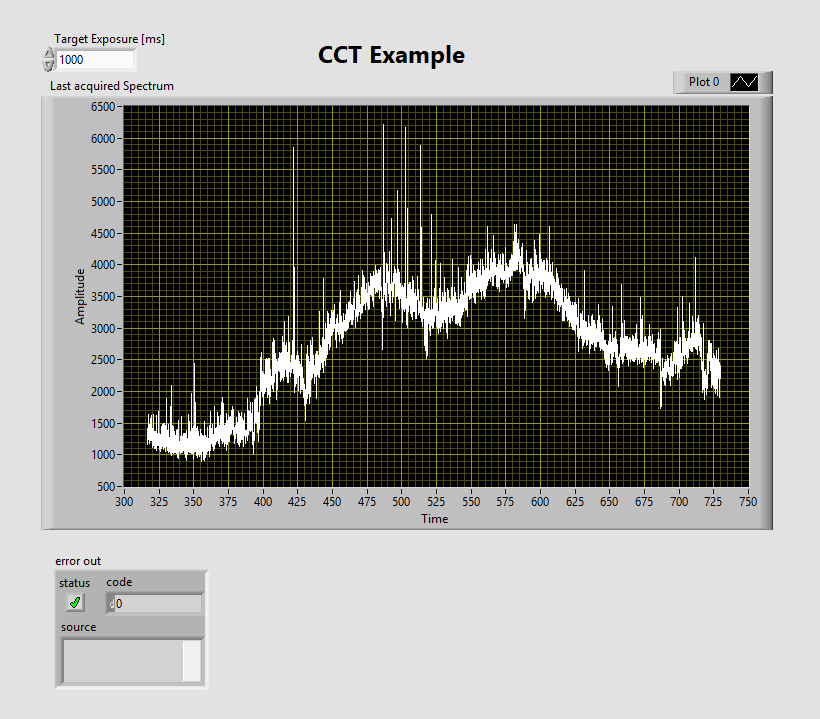
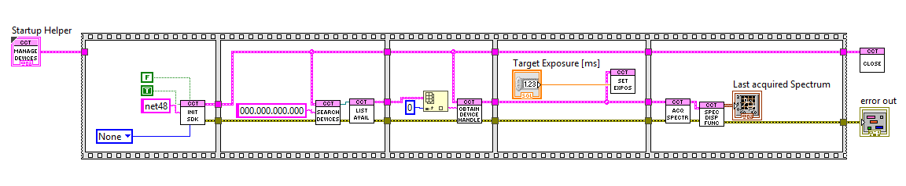

# Simple Example
Shows how to connect to the spectrometer and get a spectrum plot\
After installation of the ThorSpectra software, find cct_sdk_1.0.350.zip in C:\Program Files\Thorlabs\ThorSpectra\Examples.\
Unzip it and find an extended example in the Labview subfolder.\
Copy the simple example in the Labview folder such that the subvis can be found. 

Tested with Labview 2023 Q3, 64 Bit\
ThorSpectra software version 3.39 
 
## Front Panel

## Block Diagram

